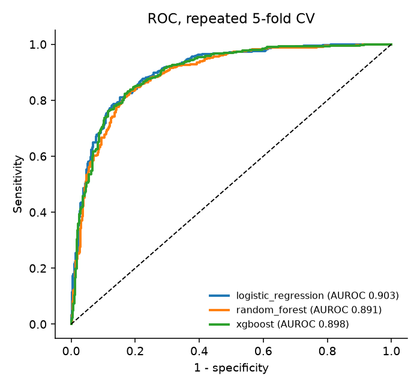
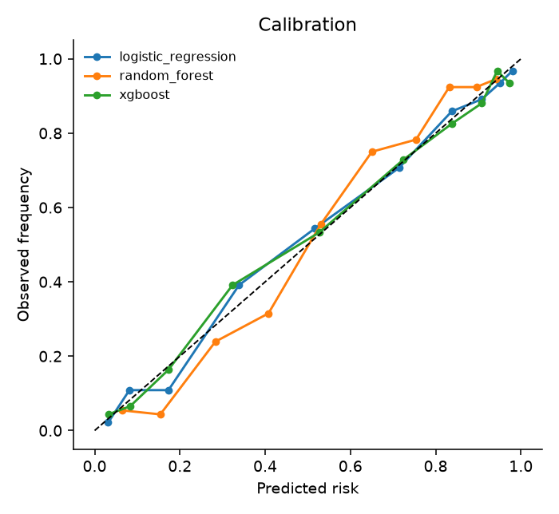

# CardioRisk: explainable coronary artery disease risk prediction

   

Multi-hospital validation of a machine-learning model that estimates the probability of
coronary artery disease from 13 routine clinical variables, with an interactive demo.

> Research prototype for education. Not a medical device. Not for clinical use.

 

## Headline results

920 patients from four hospitals (UCI Heart Disease dataset). Selected model: logistic regression.

| Evaluation | AUROC | Sensitivity | Specificity |
|---|---|---|---|
| Internal: 5x5 repeated cross-validation, hospitals pooled | 0.903 (95% CI 0.882 to 0.922) | 90.2% | 73.0% |
| External: hospital never seen in training (mean of 4) | 0.812 | 82.8% | 65.2% |

The main finding is the gap between those two rows. Pooled cross-validation, which is what most
tutorials report, overstates how the model performs at a new hospital. See
[reports/REPORT.md](reports/REPORT.md) for the analysis and
[reports/RESULTS.md](reports/RESULTS.md) for every number.

## What makes this more than a tutorial project

- **All four collection sites**, not only the 303-patient Cleveland file most projects use.
- **Leave-one-hospital-out external validation** alongside internal cross-validation.
- **Clinical metrics with confidence intervals**: AUROC, AUPRC, Brier score, calibration slope,
  sensitivity and specificity at a pre-specified 90% sensitivity operating point, bootstrap 95% CIs.
- **Decision-curve analysis** to test whether using the model beats referring everyone or no one.
- **Subgroup audit** by sex and age.
- **Explainability**: permutation importance globally, SHAP values per patient in the demo.
- **Honest handling of missing data**, which differs sharply between hospitals.
- **Reproducible**: one command downloads the data, runs every experiment, and regenerates
  every figure and table. Unit-tested metrics.

## Quick start

```bash
python -m venv .venv
.venv\Scripts\activate            # Windows   (Linux/macOS: source .venv/bin/activate)
pip install -e ".[dev]"

python -m heartrisk.train         # downloads data, runs all experiments (about 1 minute on CPU)
python -m heartrisk.report        # writes reports/RESULTS.md
pytest                            # unit tests
streamlit run app/streamlit_app.py
```

## Repository layout

```
src/heartrisk/   data.py (download + cleaning), models.py, metrics.py, train.py, report.py
app/             Streamlit demo
reports/         REPORT.md (paper-style write-up), RESULTS.md, metrics.json, figures/
tests/           unit tests for models and metrics
MODEL_CARD.md    intended use, limitations, ethical considerations
```

## Data

Janosi A, Steinbrunn W, Pfisterer M, Detrano R. Heart Disease. UCI Machine Learning Repository,
1989. https://doi.org/10.24432/C52P4X (CC BY 4.0). Downloaded automatically on first run.

## Author

Hariharan S, Department of Biomedical Engineering.

## License

Copyright (c) 2026 Hariharan S. **All rights reserved.** This repository is public for viewing
and evaluation only. Copying, reuse or redistribution of the code, text, figures or models
needs written permission from the author. See [LICENSE](LICENSE). The UCI Heart Disease data (CC BY 4.0) is credited in the README.
