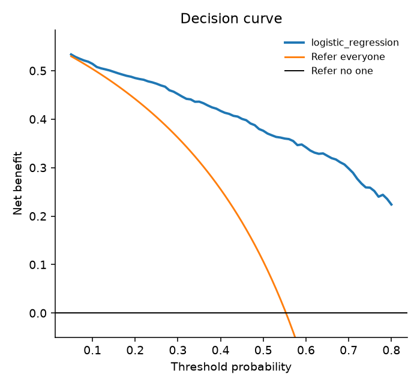
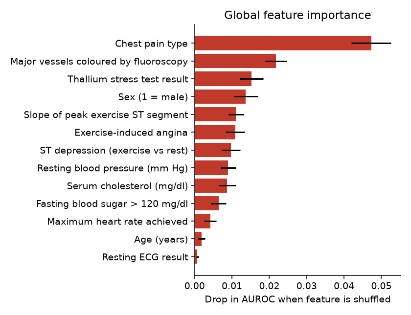

# Pooled cross-validation overstates heart-disease model performance at unseen hospitals

**Hariharan S**, Department of Biomedical Engineering

Reporting follows the TRIPOD+AI checklist items that apply to a retrospective public-data study.

## Abstract

**Background.** The UCI Heart Disease dataset is among the most used benchmarks in medical
machine learning, yet most published work uses only the Cleveland subset and reports
cross-validated accuracy. **Objective.** To develop a coronary artery disease (CAD) risk model on
all four collection sites and measure how well it transfers to a hospital absent from training.
**Methods.** 920 patients referred for coronary angiography at four centres. Three model
families (regularised logistic regression, random forest, gradient-boosted trees) were compared
using 5x5 repeated stratified cross-validation and leave-one-hospital-out validation. We report
discrimination, calibration, clinical utility and subgroup performance with bootstrap 95%
confidence intervals. **Results.** Logistic regression performed best internally (AUROC 0.903,
95% CI 0.882 to 0.922). On unseen hospitals mean AUROC fell to 0.812 (range 0.723 to 0.904), and
calibration slope fell to 0.49 at the worst site. At a shared threshold, sensitivity was 74.0%
in women and 91.9% in men. **Conclusion.** Internal validation alone gives an optimistic picture.
Differences in case mix and in which tests each hospital recorded limit transportability.

## 1. Introduction

CAD is a leading cause of death worldwide. Non-invasive risk estimation could reduce
unnecessary invasive angiography. The 1989 Detrano dataset has been reused in thousands of
student and research projects, usually with a random train/test split of the 303 Cleveland
patients. A random split tests whether a model fits one hospital's patients; it does not test
whether the model works elsewhere, which is the question that matters for deployment.

## 2. Methods

**Data source and participants.** Patients undergoing coronary angiography at the Cleveland
Clinic (n=303), the Hungarian Institute of Cardiology (n=294), University Hospitals Zurich and
Basel (n=123) and the Long Beach VA Medical Center (n=200).

**Outcome.** Angiographic CAD, defined as more than 50% diameter narrowing in any major vessel
(original label 1 to 4 versus 0).

**Predictors.** Thirteen variables: age, sex, chest pain type, resting blood pressure, serum
cholesterol, fasting blood sugar, resting ECG, maximum heart rate, exercise-induced angina, ST
depression, ST slope, number of vessels on fluoroscopy, thallium scan result.

**Missing data.** Cholesterol and blood pressure values of zero were treated as missing.
Missingness is structured by site (Results, Table in RESULTS.md): fluoroscopy vessel count is
missing for 96 to 99% of patients outside Cleveland, and cholesterol for all Swiss patients.
Linear and forest models used median imputation with missing-indicator features; XGBoost used
its native missing-value handling. Imputation was fitted inside each training fold.

**Models.** L2-regularised logistic regression, random forest (500 trees), XGBoost (300 trees,
depth 3). Hyperparameters were fixed in advance rather than tuned, to avoid optimistic bias in
a small dataset.

**Validation.** (a) Internal: 5-fold stratified cross-validation repeated 5 times on pooled
data; out-of-fold predictions averaged across repeats. (b) External: leave one hospital out.

**Operating point.** The threshold giving 90% sensitivity on internal out-of-fold predictions,
reflecting a rule-out use case. The same threshold was applied unchanged to external sites.

**Metrics.** AUROC, AUPRC, Brier score, calibration slope and intercept, sensitivity,
specificity, PPV, NPV; percentile bootstrap 95% CIs (2000 resamples); decision-curve analysis.

## 3. Results

Full tables: [RESULTS.md](RESULTS.md).

**Internal validation.** All three models performed similarly (AUROC 0.891 to 0.903). Logistic
regression had the highest AUROC and the best calibration slope (0.98).

**External validation.** Mean AUROC on an unseen hospital was 0.812 for logistic regression.
Transfer to Cleveland (0.889) and Hungary (0.904) held up; transfer to Switzerland (0.723) and
Long Beach (0.733) did not, and calibration slopes of 0.60 and 0.49 show that predicted risks
there were too extreme. With the threshold held fixed, sensitivity on unseen Cleveland patients
was 69.8% against the 90% design target.

**Subgroups.** AUROC was similar in women (0.918) and men (0.880), but at the shared threshold
sensitivity was 74.0% in women versus 91.9% in men. Women were 21% of the cohort with a disease
prevalence of 25.8% versus 63.2% in men.

**Clinical utility.** Decision-curve analysis showed positive net benefit over referring
everyone or no one across threshold probabilities of roughly 10 to 80% (figure).

**Important predictors.** Chest pain type, fluoroscopy vessel count, thallium result and sex.

 

## 4. Discussion

**Why internal results look better.** Disease prevalence ranges from 36% (Hungary) to 93%
(Switzerland), and each hospital has a distinctive pattern of missing tests. In pooled
cross-validation a model can use the missingness pattern as a proxy for the hospital, and so for
its base rate. That shortcut is unavailable when the hospital is new. The external figures are
therefore the more faithful estimate of real-world performance.

**Sex difference in sensitivity.** A single threshold tuned on a male-majority cohort misses
more disease in women. Any deployment would need sex-aware thresholds or recalibration.

**Limitations.** Data are from the 1980s and predate modern diagnostics such as high-sensitivity
troponin and CT angiography. All patients were already referred for angiography, so prevalence
far exceeds that of primary care and the model is not validated for screening. The 90%
sensitivity threshold was chosen on the same out-of-fold predictions used to report internal
sensitivity, which is mildly optimistic. No prospective evaluation was done. Race and ethnicity
are not recorded, so fairness across those groups cannot be assessed.

**Future work.** Site-wise recalibration, multiple imputation, comparison with the Diamond-
Forrester clinical score, and validation on a contemporary cohort.

## References

1. Detrano R, et al. International application of a new probability algorithm for the
   diagnosis of coronary artery disease. Am J Cardiol. 1989;64(5):304-310.
2. Collins GS, et al. TRIPOD+AI statement. BMJ. 2024;385:e078378.
3. Vickers AJ, Elkin EB. Decision curve analysis. Med Decis Making. 2006;26(6):565-574.
4. Lundberg SM, Lee SI. A unified approach to interpreting model predictions. NeurIPS 2017.
5. Van Calster B, et al. Calibration: the Achilles heel of predictive analytics. BMC Med.
   2019;17:230.
